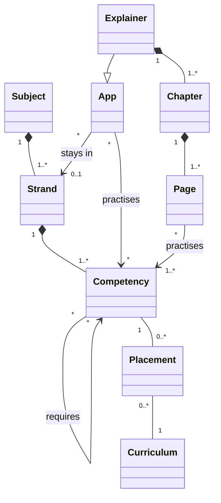

# Development Plan: apps (feat/learning-map, on branch claude/vibrant-faraday-5qg8eu)

*Started on 2026-11-02, kept by hand (no workflow server in this session, user 2026-11-03)*
*Workflow: [epcc](https://codemcp.github.io/workflows/workflows/epcc)*

## Goal

The catalog shows not only which apps exist, but what there is to learn in a subject and which of it no app covers
yet: a learning map ("Lernlandkarte") per subject, as a method across all subjects. The map of mathe-karte
(lernapps/apps#115) is the model. The same model gives apps a sensible size: one app covers one strand of a subject,
which runs over several school years and builds on itself (Algebra, Geometrie, Stochastik).

Repos involved: lernapps/apps (subject models, curricula, the map, entry format, listing checks), lernapps/app-templates
(explainer schema v2: strand and competencies), lernapps/tooling (guidance: plan an app from the map), lernapps/docs
(platform design and architecture), the explainer apps of the organisation (anorganische-chemie, elektrizitaet,
mathe-karte, musik).

## Key Decisions

### KD-01: A learning map per subject, as a method across subjects (2026-11-02)
The map of mathe-karte showed what could still be covered; the catalog today shows only what exists. The map moves
into the catalog (lernapps/apps#115) and is generic: every subject for which there is a subject model.

### KD-02: Our own terms, not the KMK's (2026-11-02)
The KMK uses "Kompetenz" for areas and single standards alike; we need words of our own (user).
- **Fach**: a school subject.
- **Strang**: a part of a subject that runs over several school years and builds on itself.
- **Baustein**: one thing a child can learn, as "Ich kann …"; belongs to exactly one Strang.
- **baut auf**: Baustein B needs Baustein A first, also across strands. A network, not a sequence (no order within a
  strand is implied, user 2026-11-02).
- **Richtstufe**: roughly in which two school years a Baustein is taught (5/6, 7/8, 9/10).
- **Lehrplan**: one curriculum, i.e. a Land and a school type ("Hessen, Gymnasium"), not "Bundesland" (user).
- **Einordnung**: in which grade(s) a Lehrplan places a Baustein.
- **Quelle**: where a subject's strands and Bausteine come from.

### KD-03: Strands come from the best available source, recorded per subject (2026-11-02)
- Mathematik: the Sachgebiete the KMK standards name per Leitidee (Arithmetik, Algebra, Funktionen, Geometrie,
  Stochastik), not the five Leitideen, which overlap ("Leitideen beziehen sich auf Sachgebiete …, sie sind jedoch
  nicht identisch mit ihnen", Mathe ESA/MSA 2022, p. 7).
- Biologie, Chemie, Physik: the areas of the "verbindliche inhaltliche Aspekte" of the 2024 standards (e.g. Physik:
  Energie, Elektrizitätslehre, Mechanik, Elektromagnetische Strahlung, Ionisierende Strahlung), not the Basiskonzepte,
  which are cross-cutting perspectives.
- Deutsch: the five Kompetenzbereiche of the KMK standards 2022.
- Subjects without KMK standards: a subject association's standards, else one Land's curriculum.

### KD-04: A Baustein belongs to exactly one Strang (2026-11-02)
Overlaps (Prozent in "Zahl und Operation" and in growth) are expressed by "baut auf", not by membership in two
strands. Coverage and gaps are counted without duplicates, and it is clear which app is responsible. The old map
worked this way (one `leitidee` per node).

### KD-05: Process competencies are not modelled (2026-11-02, user: YAGNI)
"Mathematisch argumentieren", "Lesen" etc. run through every strand. Gaps and the size of apps work without them;
they can be added later without changing the rest.

### KD-06: Richtstufe required, Einordnung optional and possibly incomplete (2026-11-02)
- Every Baustein has a Richtstufe; it is the default wherever no Lehrplan is chosen or a Lehrplan does not place it.
- A Lehrplan places a Baustein in one or more grades (Hessen: "Daten in Diagrammen" in 5, 7, 8 and 9), or not at
  all; Lehrpläne are captured step by step.
- Display (user): with a Lehrplan chosen, the rows are 5 · 5/6 · 6 · 7 · 7/8 · 8 · 9 · 9/10 · 10; placed Bausteine
  stand in their first grade ("wieder in Klasse …" for the others), unplaced ones in the striped row of their
  Richtstufe.
- The state of a Lehrplan is computed (how many Bausteine it places), not declared.

### KD-07: One app, one strand; the strand belongs to the app (2026-11-03, user)
- An app names one strand, or none; an app without a strand is not on the map.
- mathe-karte covers three strands (Prozent → Arithmetik, Binome → Algebra, Zufall → Stochastik). It has to be split;
  until then it stays unassigned. Its old page annotation is preserved in lernapps/apps#115.

### KD-08: Explainers map by their structure, other apps by a list (2026-11-03, user)
- Explainer: app → chapter → page; every page names the Bausteine it practises. The app's Bausteine are those of its
  pages, computed.
- Any other app (quiz, interactive, own apps): a list of Bausteine for the whole app in its catalog entry.
- Checks: who names Bausteine names a strand; all Bausteine of an app belong to its strand.

### KD-09: One YAML per subject, one per Lehrplan; Zod in the catalog (2026-11-03, user)
- `map/<subject>.yaml`: subject, source, strands with their Bausteine nested (so "exactly one strand" holds by
  structure).
- `map/<subject>/curricula/<land>-<school-type>.yaml`: the placements of one Lehrplan; contributed one by one.
- Zod schemas in `schemas/` like `schemas/entry.js`; JSON Schema generated. Cross-file references (ids, no cycles in
  "baut auf", strand of an app) are checked by the loader at build time and by the listing check.

### KD-10: English contract names (2026-11-03, `dec-english-contracts`)
Schemas and ids between parts of the platform are English; the German terms are for people.

| Term | Contract |
|---|---|
| Fach | `subject` |
| Strang | `strand` |
| Baustein | `competency` (as interactive's `competencies`) |
| baut auf | `requires` |
| Richtstufe | `gradeBand`: `"5-6"`, `"7-8"`, `"9-10"` |
| Lehrplan | `curriculum` |
| Einordnung | `placement`, with `grades` |

### KD-11: Explainer schema v2 with required fields (2026-11-03, user)
- `strand` in `app.yaml` is required: a strand id or `none`, so every app decides and none forgets.
- `competencies` on every page is required when `strand` is set.
- A proper new version, `explainer.v2.schema.json`; the four explainers of the organisation move in the same step.
- Reason: the model can only be established while all explainers are in our access (KD-12).

### KD-12: Now, not after the MVP (2026-11-03, user)
The map is in neither MVP (`mvp-first-draft`, `mvp-first-thanks`). Once explainers exist outside our access, such a
model can no longer be introduced. So it is built now.

### KD-13: The catalog reads an explainer's pages from the app (2026-11-03)
The explainer's build writes a list of its pages (path, title, Bausteine); the catalog reads it instead of the
hand-written `topics`. Other apps keep `topics` as plain deep links. No page is listed twice.

### KD-14: The design and the architecture are changed in lernapps/docs, by pull request (2026-11-03, user)
pdt42: a service for creators "see which app is still missing" (via `ch-app-overview`), an assumption it tests.
arc42: the map interface of `bb-catalog`, decisions (KD-07, KD-09), glossary, the risk to `qg-operable-by-one`.

## Notes

### Mockup
<https://claude.ai/artifact/P3sifwK983ynMxr7Chn8f2> (private; Design canvas, four artboards). Rounds of comments by
the user, all applied:
- Subject view: strands × rows; Lehrplan as a drop-down of all 16 Länder ("noch nicht erfasst" disabled); a sentence
  under it explains the current view; details of a Baustein in a modal, not far below; striped default rows (KD-06);
  a box "So liest du die Karte" linking the terms.
- Baustein view: Lernweg (requires / required by), Einordnung per Lehrplan, which app practises it.
- Strand view: Bausteine grouped by Richtstufe, no arrows (no implied order); apps as bars, gaps dashed.
- Terms view: a real diagram of the model; each node opens its term in a modal; "Arbeitsweise" removed (KD-05);
  "Lehrplan" instead of "Bundesland", the edge "Einordnung".

### Class model (UML)

Competency: `id` (stable), `iCan` text, `gradeBand` (required). Placement: `grades` (1..*). Curriculum: `land`,
`schoolType`, `version`. Subject: `source`.

### Facts found
- KMK Bildungsstandards (read in the originals, kmk.org):
  - Primarbereich: Deutsch, Mathematik (2022). ESA (Jg. 9): Deutsch, Mathematik (2022), erste Fremdsprache (2023).
    MSA (Jg. 10): those plus Biologie, Chemie, Physik ("Beschluss … vom 16.12.2004 i.d.F. vom 13.06.2024").
    AHR: Deutsch, Mathematik, fortgeführte Fremdsprache (2012), Biologie, Chemie, Physik (2020; dates from file names
    only). No standards for other subjects.
  - Mathe 2022: seven prozessbezogene Kompetenzen (incl. "Mit Medien mathematisch arbeiten"), five Leitideen, three
    Anforderungsbereiche; no grades within Sek I (ESA and MSA columns only); no order between contents, only
    "spiralförmig entlang wesentlicher Ideen" (p. 7).
  - Deutsch 2022: three process areas (Sprechen und Zuhören, Schreiben, Lesen), two domain areas (Sich mit Texten und
    anderen Medien auseinandersetzen, Sprache und Sprachgebrauch untersuchen), p. 13–14.
  - Biologie, Chemie, Physik 2024: four Kompetenzbereiche (Sach-, Erkenntnisgewinnungs-, Kommunikations-,
    Bewertungskompetenz); Basiskonzepte as perspectives (Physik: Erhaltung und Gleichgewichte, Modelle und
    Vorhersagen, Experimente und Verfahren, Ursache und Wirkung; Chemie: three; Biologie: five); first time
    "verbindliche inhaltliche Aspekte" (Physik five areas, Chemie by its three Basiskonzepte, Biologie four areas).
- Subjects without KMK standards (search results only, not opened): DGfG Geographie (MSA, 10th ed. 2020),
  Geschichtslehrerverband draft (2006), BDK Kunst proposal (2008), EKD Orientierungsrahmen (EKD-Texte 111, 2010/11),
  Deutsche Bischofskonferenz "Kirchliche Richtlinien zu Bildungsstandards" (2004); none found for Musik and Politik.
- The old map (mathe-karte `8b229e9`, `karte/daten/`): 5 Leitideen, 85 nodes, 16 Lehrpläne stubs, Hessen placed
  (G9 Einheiten 5.1–10.5); the data the subject model Mathematik starts from.
- app-templates: explainer = `app.yaml` → `chapters` → `chapter.yaml` → `pages`; quiz = `questions` only; interactive
  has `competencies` ("Ich kann …" texts, no ids). The catalog's `topics` is a term of none of them.
- Catalog: explainers are anorganische-chemie, elektrizitaet, mathe-karte, musik (from their paths); naturwunder-quiz
  is a quiz; kniffel-trainer, textcheck, typonaut are own apps.

### Classification in the platform design and the architecture (lernapps/docs, read 2026-11-03)
- pdt42: the map serves `t-find-app` ("a matching app for one topic and one grade"), `ch-app-overview` ("Finding by
  topic and grade", "Tailored to the visitor without accounts": the Lehrplan in the address, nothing stored),
  `s-student-finding` / `x-child-struggles` (what is missing before), `x-tailor-made-app` (a gap made visible).
  Missing: a service for creators to see gaps; an assumption the map tests (close to `a-set-scope-creators`).
- arc42: `bb-catalog` owns the subject models and curricula and offers the map (pages and JSON for assistants,
  `concept-assistants-as-readers`); `if-listing` checks the ids and the strand rule (`concept-checked-not-declared`);
  `if-archetypes` carries the explainer v2 contract; `if-guidance` (tooling) plans an app from the map. Risk: one
  owner cannot maintain models and 16 curricula (`risk-one-owner`, `qg-operable-by-one`); mitigated by KD-06.

### Open points
- A rule for the size of a Baustein: those a Lehrplan names in many grades may be too coarse (target 40–70 per
  subject in Sek I; the old map has 85).
- Who maintains a subject model, and who decides on changes.
- The split of mathe-karte into three apps: its own piece of work.

## Explore
### Phase Entrance Criteria
- The need is stated: the catalog has no overview of what could be covered (user, 2026-11-02); lernapps/apps#115.

### Tasks
- [x] Read lernapps/apps#115 and the old map's data model (mathe-karte `8b229e9`)
- [x] KMK Bildungsstandards checked in the originals (Mathe, Deutsch, Biologie, Chemie, Physik)
- [x] Subjects without KMK standards: what exists (search only)
- [x] Terms of our own (KD-02); one strand per Baustein (KD-04); no process competencies (KD-05)
- [x] Mockup, five rounds of comments (Notes, "Mockup")
- [x] Richtstufe and Einordnung (KD-06); Lehrplan instead of Bundesland
- [x] Class model (Notes, "Class model")
- [x] Storage and schema (KD-09, KD-10); terms of the archetypes in app-templates
- [x] Strand at the app (KD-07); explainers by structure, others by list (KD-08); v2 (KD-11); now (KD-12)
- [x] Classification with pdt and arc42 (Notes)

### Completed
- [x] Created development plan file

## Plan
### Phase Entrance Criteria
- The model, its terms and its storage are decided (KD-02 to KD-11).
- The classification in the platform design and the architecture is done.

### Tasks
- [x] Order of the work and what runs in parallel (below)
- [ ] Break each step into the tasks of Code (current)
- [ ] User approves the plan

### Implementation strategy
Step 0 first; then A to E in parallel; F and G at the end. One pull request per repo.

```text
0 ─┬─ A
   ├─ B ─┬─ E ─┐
   ├─ C ─┼─────┼─ F ─ G
   └─ D  ┘     ┘
```

**0. The contract** (before anything else)
Field names (KD-10), files (KD-09), the explainer v2 fields (KD-11), the entry's new fields (`strand`, `competencies`
for non-explainers), the page list an explainer's build writes. One short page; the user decides.

**A. lernapps/docs**
pdt42 service and assumption; arc42 interface, decisions, glossary, risk (KD-14). Pull request.

**B. lernapps/apps**
Zod schemas and loader checks; `map/mathematik.yaml` from the old map, `map/mathematik/curricula/he-gymnasium.yaml`;
JSON of the map; the map pages after the mockup; `strand` and `competencies` in the entry.

**C. lernapps/app-templates**
`explainer.v2.schema.json`: `strand` in `app.yaml`, `competencies` on every page; the build writes the page list.

**D. lernapps/tooling**
The planning skill picks strand and Bausteine from the map; final wording after A and C.

**E. Subject models** (after B's schema; three independent pieces)
Physik, Chemie, Musik.

**F. Listing check** (after B and C)
For explainers, read the page list from the app; check ids and the strand rule.

**G. Move the explainers** (after C, E, F)
elektrizitaet, anorganische-chemie, musik get strand and competencies on v2 and are listed again; mathe-karte moves
to v2 with `strand: none`.

### Completed
*None yet*

## Code
### Phase Entrance Criteria
- The plan names the tasks per repo and their order.
- The user approved the plan.

### Tasks
- [ ] *To be added once the Plan breaks the steps down*

### Completed
*None yet*

## Commit
### Phase Entrance Criteria
- All changes are implemented, and the checks and tests of each repo pass.
- The map shows Mathematik with the Lehrplan Hessen, and at least one explainer on v2 is on it.

### Tasks
- [ ] *To be added when this phase becomes active*

### Completed
*None yet*

---
*This plan is maintained by the LLM, by hand in this session.*
