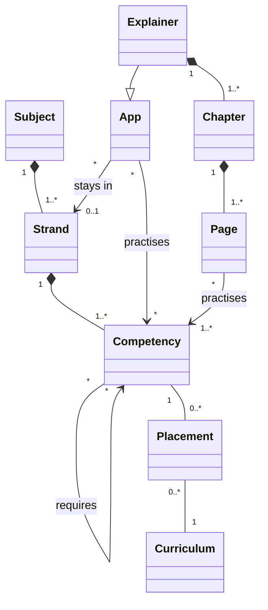

# Development Plan: apps (feat/learning-map, on branch claude/vibrant-faraday-5qg8eu)

*Started on 2026-11-02, kept by hand (no workflow server in this session, user 2026-11-03)*
*Workflow: [epcc](https://codemcp.github.io/workflows/workflows/epcc)*

## Goal

The catalog shows not only which apps exist, but what there is to learn in a subject and which of it no app covers
yet: a learning map ("Lernlandkarte") per subject, as a method across all subjects. The map of mathe-karte
(lernapps/apps#115) is the model. The same model gives apps a sensible size: one app covers one strand of a subject,
which runs over several school years and builds on itself (Algebra, Geometrie, Stochastik).

Repos involved: lernapps/apps (subject models, curricula, the map, entry format, listing checks), lernapps/app-templates
(explainer schema v2: strand and competencies), lernapps/tooling (guidance: plan an app from the map), lernapps/docs
(platform design and architecture), the explainer apps of the organisation (anorganische-chemie, elektrizitaet,
mathe-karte, musik).

## Key Decisions

### KD-01: A learning map per subject, as a method across subjects (2026-11-02)
The map of mathe-karte showed what could still be covered; the catalog today shows only what exists. The map moves
into the catalog (lernapps/apps#115) and is generic: every subject for which there is a subject model.

### KD-02: Our own terms, not the KMK's (2026-11-02)
The KMK uses "Kompetenz" for areas and single standards alike; we need words of our own (user).
- **Fach**: a school subject.
- **Strang**: a part of a subject that runs over several school years and builds on itself.
- **Baustein**: one thing a child can learn, as "Ich kann …"; belongs to exactly one Strang.
- **baut auf**: Baustein B needs Baustein A first, also across strands. A network, not a sequence (no order within a
  strand is implied, user 2026-11-02).
- **Richtstufe**: roughly in which two school years a Baustein is taught (5/6, 7/8, 9/10).
- **Lehrplan**: one curriculum, i.e. a Land and a school type ("Hessen, Gymnasium"), not "Bundesland" (user).
- **Einordnung**: in which grade(s) a Lehrplan places a Baustein.
- **Quelle**: where a subject's strands and Bausteine come from.

### KD-03: Strands come from the best available source, recorded per subject (2026-11-02)
- Mathematik: the Sachgebiete the KMK standards name per Leitidee (Arithmetik, Algebra, Funktionen, Geometrie,
  Stochastik), not the five Leitideen, which overlap ("Leitideen beziehen sich auf Sachgebiete …, sie sind jedoch
  nicht identisch mit ihnen", Mathe ESA/MSA 2022, p. 7).
- Biologie, Chemie, Physik: the areas of the "verbindliche inhaltliche Aspekte" of the 2024 standards (e.g. Physik:
  Energie, Elektrizitätslehre, Mechanik, Elektromagnetische Strahlung, Ionisierende Strahlung), not the Basiskonzepte,
  which are cross-cutting perspectives.
- Deutsch: the five Kompetenzbereiche of the KMK standards 2022.
- Subjects without KMK standards: a subject association's standards, else one Land's curriculum.

### KD-04: A Baustein belongs to exactly one Strang (2026-11-02)
Overlaps (Prozent in "Zahl und Operation" and in growth) are expressed by "baut auf", not by membership in two
strands. Coverage and gaps are counted without duplicates, and it is clear which app is responsible. The old map
worked this way (one `leitidee` per node).

### KD-05: Process competencies are not modelled (2026-11-02, user: YAGNI)
"Mathematisch argumentieren", "Lesen" etc. run through every strand. Gaps and the size of apps work without them;
they can be added later without changing the rest.

### KD-06: Richtstufe required, Einordnung optional and possibly incomplete (2026-11-02)
- Every Baustein has a Richtstufe; it is the default wherever no Lehrplan is chosen or a Lehrplan does not place it.
- A Lehrplan places a Baustein in one or more grades (Hessen: "Daten in Diagrammen" in 5, 7, 8 and 9), or not at
  all; Lehrpläne are captured step by step.
- Display (user): with a Lehrplan chosen, the rows are 5 · 5/6 · 6 · 7 · 7/8 · 8 · 9 · 9/10 · 10; placed Bausteine
  stand in their first grade ("wieder in Klasse …" for the others), unplaced ones in the striped row of their
  Richtstufe.
- The state of a Lehrplan is computed (how many Bausteine it places), not declared.

### KD-07: One app, one strand; the strand belongs to the app (2026-11-03, user)
- An app names one strand, or none; an app without a strand is not on the map.
- mathe-karte covers three strands (Prozent → Arithmetik, Binome → Algebra, Zufall → Stochastik). It has to be split;
  until then it stays unassigned. Its old page annotation is preserved in lernapps/apps#115.

### KD-08: Explainers map by their structure, other apps by a list (2026-11-03, user)
- Explainer: app → chapter → page; every page names the Bausteine it practises. The app's Bausteine are those of its
  pages, computed.
- Any other app (quiz, interactive, own apps): a list of Bausteine for the whole app in its catalog entry.
- Checks: who names Bausteine names a strand; all Bausteine of an app belong to its strand.

### KD-09: One YAML per subject, one per Lehrplan; Zod in the catalog (2026-11-03, user)
- `map/<subject>.yaml`: subject, source, strands with their Bausteine nested (so "exactly one strand" holds by
  structure).
- `map/<subject>/curricula/<land>-<school-type>.yaml`: the placements of one Lehrplan; contributed one by one.
- Zod schemas in `schemas/` like `schemas/entry.js`; JSON Schema generated. Cross-file references (ids, no cycles in
  "baut auf", strand of an app) are checked by the loader at build time and by the listing check.

### KD-10: English contract names (2026-11-03, `dec-english-contracts`)
Schemas and ids between parts of the platform are English; the German terms are for people.

| Term | Contract |
|---|---|
| Fach | `subject` |
| Strang | `strand` |
| Baustein | `competency` (as interactive's `competencies`) |
| baut auf | `requires` |
| Richtstufe | `gradeBand`: `"5-6"`, `"7-8"`, `"9-10"` |
| Lehrplan | `curriculum` |
| Einordnung | `placement`, with `grades` |

### KD-11: Explainer schema v2 with required fields (2026-11-03, user)
- `strand` in `app.yaml` is required: a strand id or `none`, so every app decides and none forgets.
- `competencies` on every page is required when `strand` is set.
- A proper new version, `explainer.v2.schema.json`; the four explainers of the organisation move in the same step.
- Reason: the model can only be established while all explainers are in our access (KD-12).

### KD-12: Now, not after the MVP (2026-11-03, user)
The map is in neither MVP (`mvp-first-draft`, `mvp-first-thanks`). Once explainers exist outside our access, such a
model can no longer be introduced. So it is built now.

### KD-13: The catalog reads an explainer's pages from the app (2026-11-03)
The explainer's build writes a list of its pages (path, title, Bausteine); the catalog reads it instead of the
hand-written `topics`. Other apps keep `topics` as plain deep links. No page is listed twice.

### KD-14: The design and the architecture are changed in lernapps/docs, by pull request (2026-11-03, user)
pdt42: a service for creators "see which app is still missing" (via `ch-app-overview`), an assumption it tests.
arc42: the map interface of `bb-catalog`, decisions (KD-07, KD-09), glossary, the risk to `qg-operable-by-one`.

### KD-15: The map pages are static, one per view and Lehrplan, enhanced by small scripts (2026-11-03, proposed)
Every page of the catalog is readable without JavaScript (`dec-static-sites`, README). So the map is built at build
time, like the app pages:
- One page per subject and Lehrplan: `/apps/map/<subject>/` (Richtstufe) and `/apps/map/<subject>/<curriculum>/`;
  the drop-down is a form that links there; a small script navigates on change.
- One page per strand (`/apps/map/<subject>/<strand>/`) and per Baustein (`/apps/map/<subject>/c/<competency>/`).
- A Baustein in the grid is a link to its page; a script opens the same content as a modal (`<dialog>`) instead.
- "Nur Lücken zeigen" is a filter by script; without it, all Bausteine show.
- `/apps/map/` explains the terms: the model as a diagram, each node a link to its definition on the same page, which
  a script opens as a modal. German at the root, English under `/apps/en/map/…`, texts in `de.js` and `en.js`.
- Nothing is stored and nothing is counted beyond the site frame's page totals; the Lehrplan is in the address
  (`ch-app-overview`: "Tailored to the visitor without accounts").

### KD-16: No target number of Bausteine; the source's areas set the size (2026-11-03, user)
The old map's "40–70 per subject" was a magic number. A subject model follows the areas and contents its source
gives (KMK standards or the like); the old map's 85 nodes are taken over as they are (B4), only moved to the strands.

### KD-17: Musik is based on the Hessian curriculum (2026-11-03, user)
No KMK standards exist for Musik; its subject model takes the Kerncurriculum Musik Hessen as its source (E3).

### KD-18: Access and parallel work (2026-11-03, user)
- Repos of the organisation lernapps and of the account mrsimpson may be added to the session; branches and pull
  requests may be opened there, and merged when they change only metadata. Branch name everywhere:
  `claude/vibrant-faraday-5qg8eu`.
- Work runs in parallel wherever it can (A–E, E1–E3), with sub-agents.

### KD-19: Three stages for the map's rules (2026-11-03, user)
- Scoping: the assistant checks the subject's map and recommends a strand if one fits; `strand: none` is allowed and
  the app is listed normally, only not on the map (refines KD-07).
- With a strand, the app practises only the competencies of that strand and invents none; missing ones are proposed to
  the catalog. The listing rule `entry-learning-map` makes an unknown id and a competency of another strand an error.
- The content of a page matches the "Ich kann …" of its competencies: judged in the review.

### KD-20: anorganische-chemie is split strictly by strand (2026-11-03, user)
Its two pages on reactions (`reaktionen/reaktionen`, `reaktionen/reaktionsgleichungen`) go to an app of the strand
`chemie/chemische-reaktion` (repo still to be created); `reaktionen/symbole-formeln` belongs to `stoffe-und-teilchen`.

### KD-21: Links across explainers later, via the map (2026-11-03, user)
lernapps/app-templates#130: bundle the subject YAML with the explainer, validate ids locally, link across apps.

### KD-22: What a review judges is a hint (2026-11-03, user)
`content-matches-competencies` and `strand-from-map` are hints; only programmatic checks are errors.

### KD-23: Fine granularity from the research; the proposals are adopted (2026-11-03, user)
Each subject model was reworked from the KMK standards and at least three Länder curricula (reports in the session's
scratchpad, summarised in the pull request): Mathematik 127, Physik 108, Chemie 75, Musik 187 competencies; Musik in
nine strands. The ids used by apps stay, except two of musik's unbacked ones (the app has `strand: none`). Assumed,
not yet answered: Musik with 9 strands rather than one "Musiklehre"; no strand "Wärmelehre" in Physik; Chemie keeps
the organic block.

### KD-24: One page per competency as a rule; early advice in `lernapps check` (2026-11-03, user; supersedes a first
reading "exactly one `competency` per page": the schema keeps the list `competencies`)
- As a rule one page per competency; several pages for a large one are fine; several competencies on one page are
  advised against: a hint of `lernapps check` (`one-competency-per-page`), not a schema rule.
- `lernapps check` fetches the subject's map and warns about unknown ids or another strand (`competencies-on-map`)
  before the listing; without network it says it could not check.

### KD-25: requires may cross strands; an app practises only its own (2026-11-03, user)
A competency may build on one of another strand (about 20 % of the edges in Mathematik, Chemie, Musik). The app does
not practise it; it assumes it and points to it.

### KD-26: Recap pages for prerequisites of other strands (2026-11-03, user)
A page with `recap: <subject>/<competency>` instead of `competencies`: descriptive blocks only, no exercise; the
runtime writes the link to the competency's page on the map, so it cannot be missing; the link always leads to the
map, never directly into another app (the app knows no other apps; several or none may practise the competency; the
map stays current and lists them with deep links); the recapped competency is of
another strand (checked by `lernapps check` and the listing); it counts as nothing on the map. Rule
`prerequisites-linked` (hint) in `lernapps check`: a prerequisite of another strand without a recap page or a link.
Later (lernapps/app-templates#130) the runtime shows "Das brauchst du vorher" from the bundled map by itself.

### KD-27: A recap page for any prerequisite the app does not practise (2026-11-03, user, variant C)
Refines KD-26: a recap may repeat a competency of any strand, also of the app's own, as long as the app does not
practise it on a page of its own (that is an error). Found in test run 2: prerequisites of the own strand outside the
app's scope (`energie-und-joule`) had no clean way. `prerequisites-linked` covers every prerequisite the app does not
practise.

## Notes

### Mockup
<https://claude.ai/artifact/P3sifwK983ynMxr7Chn8f2> (private; Design canvas, four artboards). Rounds of comments by
the user, all applied:
- Subject view: strands × rows; Lehrplan as a drop-down of all 16 Länder ("noch nicht erfasst" disabled); a sentence
  under it explains the current view; details of a Baustein in a modal, not far below; striped default rows (KD-06);
  a box "So liest du die Karte" linking the terms.
- Baustein view: Lernweg (requires / required by), Einordnung per Lehrplan, which app practises it.
- Strand view: Bausteine grouped by Richtstufe, no arrows (no implied order); apps as bars, gaps dashed.
- Terms view: a real diagram of the model; each node opens its term in a modal; "Arbeitsweise" removed (KD-05);
  "Lehrplan" instead of "Bundesland", the edge "Einordnung".

### Class model (UML)

Competency: `id` (stable), `iCan` text, `gradeBand` (required). Placement: `grades` (1..*). Curriculum: `land`,
`schoolType`, `version`. Subject: `source`.

### Facts found
- KMK Bildungsstandards (read in the originals, kmk.org):
  - Primarbereich: Deutsch, Mathematik (2022). ESA (Jg. 9): Deutsch, Mathematik (2022), erste Fremdsprache (2023).
    MSA (Jg. 10): those plus Biologie, Chemie, Physik ("Beschluss … vom 16.12.2004 i.d.F. vom 13.06.2024").
    AHR: Deutsch, Mathematik, fortgeführte Fremdsprache (2012), Biologie, Chemie, Physik (2020; dates from file names
    only). No standards for other subjects.
  - Mathe 2022: seven prozessbezogene Kompetenzen (incl. "Mit Medien mathematisch arbeiten"), five Leitideen, three
    Anforderungsbereiche; no grades within Sek I (ESA and MSA columns only); no order between contents, only
    "spiralförmig entlang wesentlicher Ideen" (p. 7).
  - Deutsch 2022: three process areas (Sprechen und Zuhören, Schreiben, Lesen), two domain areas (Sich mit Texten und
    anderen Medien auseinandersetzen, Sprache und Sprachgebrauch untersuchen), p. 13–14.
  - Biologie, Chemie, Physik 2024: four Kompetenzbereiche (Sach-, Erkenntnisgewinnungs-, Kommunikations-,
    Bewertungskompetenz); Basiskonzepte as perspectives (Physik: Erhaltung und Gleichgewichte, Modelle und
    Vorhersagen, Experimente und Verfahren, Ursache und Wirkung; Chemie: three; Biologie: five); first time
    "verbindliche inhaltliche Aspekte" (Physik five areas, Chemie by its three Basiskonzepte, Biologie four areas).
- Subjects without KMK standards (search results only, not opened): DGfG Geographie (MSA, 10th ed. 2020),
  Geschichtslehrerverband draft (2006), BDK Kunst proposal (2008), EKD Orientierungsrahmen (EKD-Texte 111, 2010/11),
  Deutsche Bischofskonferenz "Kirchliche Richtlinien zu Bildungsstandards" (2004); none found for Musik and Politik.
- The old map (mathe-karte `8b229e9`, `karte/daten/`): 5 Leitideen, 85 nodes, 16 Lehrpläne stubs, Hessen placed
  (G9 Einheiten 5.1–10.5); the data the subject model Mathematik starts from.
- app-templates: explainer = `app.yaml` → `chapters` → `chapter.yaml` → `pages`; quiz = `questions` only; interactive
  has `competencies` ("Ich kann …" texts, no ids). The catalog's `topics` is a term of none of them.
- Catalog: explainers are anorganische-chemie, elektrizitaet, mathe-karte, musik (from their paths); naturwunder-quiz
  is a quiz; kniffel-trainer, textcheck, typonaut are own apps.

### Classification in the platform design and the architecture (lernapps/docs, read 2026-11-03)
- pdt42: the map serves `t-find-app` ("a matching app for one topic and one grade"), `ch-app-overview` ("Finding by
  topic and grade", "Tailored to the visitor without accounts": the Lehrplan in the address, nothing stored),
  `s-student-finding` / `x-child-struggles` (what is missing before), `x-tailor-made-app` (a gap made visible).
  Missing: a service for creators to see gaps; an assumption the map tests (close to `a-set-scope-creators`).
- arc42: `bb-catalog` owns the subject models and curricula and offers the map (pages and JSON for assistants,
  `concept-assistants-as-readers`); `if-listing` checks the ids and the strand rule (`concept-checked-not-declared`);
  `if-archetypes` carries the explainer v2 contract; `if-guidance` (tooling) plans an app from the map. Risk: one
  owner cannot maintain models and 16 curricula (`risk-one-owner`, `qg-operable-by-one`); mitigated by KD-06.

### Open points
- Who maintains a subject model, and who decides on changes.
- The split of mathe-karte (step H): decided (user, 2026-11-03): repos mathe-arithmetik, mathe-algebra,
  mathe-stochastik; mathe-karte stays as it is, on format 1, not on the map.
- musik spans several strands of the Hessian curriculum (best fit `parameter`, 6 of 29 links): format 2 with
  `strand: none` until the owner decides (split, or one strand).
- anorganische-chemie: strand `chemie/stoffe-und-teilchen`; its two reaction pages practise competencies of
  `chemische-reaktion`, which is now a listing ERROR (KD-19): the split (KD-20) needs a new repo from the owner
  (proposed name `chemie-reaktionen`); `reaktionen/symbole-formeln` moves to a chapter of strand 1.
- Grade bands: since the research (KD-23) all four subjects take bands from the majority of three Länder curricula;
  NRW grades are read from example school plans; Hessian texts are 2011–2016; Musik's KC is a draft.
- lernapps/docs: the assumption `a-gaps-guide-creators` had to name an MVP; it names `mvp-first-draft`.
- `strand-from-map` judges only apps built with the tooling (scope tooling); scope `listing` would include freely
  built apps (still a hint): owner to decide.
- `prerequisites-linked` does not check that a recap page stands before the page that needs it (guidance only).
- Open questions of the research (reports `research-<subject>/report.md` in the session scratchpad): Physik sixth
  strand "Wärmelehre"; Chemie organic block and the size of strand 1 (46); Musik 9 strands vs. one "Musiklehre";
  Mathematik thinly backed splits.

### Test runs of the guidance (2026-11-03, up to four, user)
Each run: a fresh session (model of a lower tier) builds a small explainer locally, without GitHub; it announces every
skill it reads (first run: asked the parent for them); the parent plays the creator and logs what it reads
(`test-*-log.md` in the session scratchpad).
1. Trigonometrie (session_016Nmpwa1mNLrTq25wxKSnFa): strand mathematik/geometrie, `trigonometrie` +
   `sinus-kosinussatz`, format 2, one page each; build and check green. Findings and fixes: tooling AGENTS.md misled
   an app builder (fixed: one line points to guidance/AGENTS.md); chapters of competencies that build on each other
   applied only when asked (fixed: research checkpoint says the map decides the structure, no curriculum search);
   skill named schema v1, no `\sin`/Greek in formulas, no trig/sqrt in `generated`, build/screenshot folders differ,
   `create` output, `init` from a local build (all fixed in app-templates e5a1195/4fdc214 and tooling f165ac6).
2. Physik, Lage- und Bewegungsenergie (session_016NmpwaDbGcPWzYDmQJbwxS): strand physik/energie,
   `lageenergie-berechnen` + `bewegungsenergie-berechnen`; recap pages for `gewichtskraft-berechnen` and
   `geschwindigkeit-berechnen` (mechanik), unprompted; build and check green. Findings: `create` writes a FORMAT-1
   scaffold (tooling depends on app-templates 0.2.1); the map checks never ran (no local server allowed in its sandbox,
   `file:` not accepted by the test variable); `init` does not install app-templates and links the local build
   (playwright missing); prerequisites of the own strand had no rule (→ KD-27); docs gaps (inline records only text,
   data field names lower-case, `bar` only parts, "README of each archetype in question").
3. Chemie, Reaktionsgleichungen (session_016NmpwbGeqWRN1B1tRhdz9u), after tooling 35c6089: strand
   chemie/chemische-reaktion, `wortgleichung` + `reaktionsgleichung-aufstellen`; recap pages for
   `formeln-von-verbindungen` (other strand) and `massenerhaltung` (own strand, KD-27); links for the two others;
   one chapter after the creator's question (rule then moved into the research task, tooling d3d2a35); `init` and
   `create` worked (format 2); `lernapps check` WITH the map: `prerequisites-linked` hinted a missing link, then ok
   (15 rules). A contradiction README vs. skills on recap pages was found and fixed (app-templates 38c63dc).
   Remaining small findings (not about the map): the app-content skeleton heading "Rules learned from mistakes" is
   named nowhere; `\ce{}` with record placeholders in `generated` loses subscripts; `init` in an existing repo does
   not create `work`; `scope` fields only in rules.md.

## Explore
### Phase Entrance Criteria
- The need is stated: the catalog has no overview of what could be covered (user, 2026-11-02); lernapps/apps#115.

### Tasks
- [x] Read lernapps/apps#115 and the old map's data model (mathe-karte `8b229e9`)
- [x] KMK Bildungsstandards checked in the originals (Mathe, Deutsch, Biologie, Chemie, Physik)
- [x] Subjects without KMK standards: what exists (search only)
- [x] Terms of our own (KD-02); one strand per Baustein (KD-04); no process competencies (KD-05)
- [x] Mockup, five rounds of comments (Notes, "Mockup")
- [x] Richtstufe and Einordnung (KD-06); Lehrplan instead of Bundesland
- [x] Class model (Notes, "Class model")
- [x] Storage and schema (KD-09, KD-10); terms of the archetypes in app-templates
- [x] Strand at the app (KD-07); explainers by structure, others by list (KD-08); v2 (KD-11); now (KD-12)
- [x] Classification with pdt and arc42 (Notes)

### Completed
- [x] Created development plan file

## Plan
### Phase Entrance Criteria
- The model, its terms and its storage are decided (KD-02 to KD-11).
- The classification in the platform design and the architecture is done.

### Tasks
- [x] Order of the work and what runs in parallel (below)
- [x] Break each step into the tasks of Code, including the map pages after the mockup (KD-15, Code tasks)
- [x] User decides KD-15 (static pages per view and Lehrplan): "sieht gut aus" (2026-11-03)
- [x] User approves the plan (2026-11-03), to be worked on autonomously overnight

### Implementation strategy
Step 0 first; then A to E in parallel; F and G at the end. One pull request per repo.

```text
0 ─┬─ A
   ├─ B ─┬─ E ─┐
   ├─ C ─┼─────┼─ F ─ G
   └─ D  ┘     ┘
```

**0. The contract** (before anything else)
Field names (KD-10), files (KD-09), the explainer v2 fields (KD-11), the entry's new fields (`strand`, `competencies`
for non-explainers), the page list an explainer's build writes. One short page; the user decides.

**A. lernapps/docs**
pdt42 service and assumption; arc42 interface, decisions, glossary, risk (KD-14). Pull request.

**B. lernapps/apps**
Zod schemas and loader checks; `map/mathematik.yaml` from the old map, `map/mathematik/curricula/he-gymnasium.yaml`;
JSON of the map; the map pages after the mockup; `strand` and `competencies` in the entry.

**C. lernapps/app-templates**
`explainer.v2.schema.json`: `strand` in `app.yaml`, `competencies` on every page; the build writes the page list.

**D. lernapps/tooling**
The planning skill picks strand and Bausteine from the map; final wording after A and C.

**E. Subject models** (after B's schema; three independent pieces)
Physik, Chemie, Musik.

**F. Listing check** (after B and C)
For explainers, read the page list from the app; check ids and the strand rule.

**G. Move the explainers** (after C, E, F)
elektrizitaet, anorganische-chemie, musik get strand and competencies on v2 and are listed again; mathe-karte moves
to v2 with `strand: none`.

### Completed
*None yet*

## Code
### Phase Entrance Criteria
- The plan names the tasks per repo and their order.
- The user approved the plan.

### Tasks
Ids say the step; tasks of one step run in order, steps as in the Plan's strategy.

**0. The contract** (lernapps/apps, this branch; the user decides before A–E start)
- [x] 0.1 `docs/learning-map-contract.md`: the files (KD-09), every field with type and rule (KD-10), the explainer v2
  fields (KD-11), the entry's `strand` and `competencies`, and the page list an explainer's build writes
  (`lernapps-pages.json`: path, title, competencies per page)
- [x] 0.2 Examples in it: an excerpt of `map/mathematik.yaml`, of `he-gymnasium.yaml`, an explainer `app.yaml` and page,
  an entry of a quiz with `competencies`

**A. lernapps/docs** (pull request; repo added to the session first)
- [x] A1 pdt42: service "see which app is still missing" for `e-creators` via `ch-app-overview`; assumption
  "creators build for a visible gap" (`mvp`: none yet, or the next one); `npx pdt42 … validate`
- [x] A2 arc42: interface `if-learning-map` of `bb-catalog` (pages and JSON under `lernapps.net/apps/map/`,
  `x-realises: ch-app-overview`); decisions "the learning map belongs to the catalog" (KD-09) and "one app, one strand"
  (KD-07); `if-archetypes` names the explainer v2 contract; glossary (KD-02, KD-10); risk to `qg-operable-by-one`;
  `npx arc42 … validate`

**B. lernapps/apps: model, data, entry**
- [x] B1 `schemas/map.js` (Zod): `Subject` (source, strands with competencies nested), `Curriculum` (placements);
  `npm run schema` writes `subject.v1.schema.json` and `curriculum.v1.schema.json`; `npm run check` fails when stale
- [x] B2 `src/_data/map.js`: reads `map/*.yaml` and `map/*/curricula/*.yaml`, checks them, and checks across files:
  unique ids per subject, every `requires` and `placement.competency` exists, no cycles in `requires`, at most one
  placement per competency and curriculum; a broken file fails the build (like `catalog.js`)
- [x] B3 Computed per subject: coverage per competency (which apps, which pages), per strand (covered of total), per
  curriculum (placed of total); the rows of KD-06 for each curriculum
- [x] B4 `map/mathematik.yaml` from the old map (`8b229e9`): the 85 nodes moved to the five Sachgebiete (KD-03),
  `iCan` texts, `gradeBand`, `requires` where the old data or the explainer's pages say so; `source`: KMK 2022
- [x] B5 `map/mathematik/curricula/he-gymnasium.yaml` from the old Hessen table (grades per competency; Einheiten as a
  comment or a field `unit`, decided in 0.1)
- [x] B6 Entry (`schemas/entry.js`): `strand` (`{ subject, strand }` or `none`) and `competencies` (ids) for apps that
  are not explainers; tests and fixtures; `src/llms.njk` explains both
- [x] B7 JSON of the map at `/apps/map/<subject>.json` (model, curricula, coverage) for assistants and the tooling;
  linked from `llms.txt`

**B. lernapps/apps: the map pages, after the mockup** (KD-15)
- [x] B8 Subject view `/apps/map/<subject>/` and `/<subject>/<curriculum>/`: grid strands × rows (Richtstufe, or the
  rows of KD-06 with striped default rows and "noch ohne Klasse"); per strand "x von y Bausteinen geübt" with a bar;
  a Baustein covered (filled) or a gap (dashed), "wieder in Klasse …"; box "So liest du die Karte" linking the terms;
  the Lehrplan drop-down (all 16 Länder, not captured ones disabled) with the sentence that explains the current view;
  the grid scrolls sideways in its own box at phone width
- [x] B9 Script `src/assets/map.js`: navigate on drop-down change; "Nur Lücken zeigen"; open a Baustein as `<dialog>`
  (strand, Richtstufe, the chosen Lehrplan's grades or "noch nicht zugeordnet", requires, practised in, link to its
  page), closed by its button, Escape or the backdrop; focus back on the Baustein
- [x] B10 Baustein page `/apps/map/<subject>/c/<id>/`: "Ich kann …", strand, source; Lernweg (requires, required by,
  also from other strands); table "Wann ist er dran?" (Richtstufe and every curriculum, "noch nicht erfasst"); apps
  and pages that practise it; link "Baue eine App für diesen Strang" to `/apps/build/`
- [x] B11 Strand page `/apps/map/<subject>/<strand>/`: Bausteine grouped by Richtstufe, no arrows; apps of the strand
  as bars over the Richtstufen they cover, gaps dashed; the box "Eine App für diesen Strang bauen"
- [x] B12 Terms page `/apps/map/`: the model as a diagram (HTML and CSS, nodes are links); definitions on the same
  page, opened as `<dialog>` by the script; the three rules; the list of subjects with a map
- [x] B13 Texts in `de.js` and `en.js` (plain German, ISO 24495-1); macros in `components.njk` (Baustein chip, strand
  head, dialog); the pages in both languages; links from the start page and from an app's page (its strand and
  Bausteine)
- [x] B14 Tests: the loader's checks (fixtures with a broken id, a cycle, a double placement), the rows of KD-06, the
  coverage; `npm run check` (`lernapps-check`: links, no external resources) over the new pages; a browser test of
  the dialog and the drop-down with the keyboard

**C. lernapps/app-templates** (pull request; repo added to the session first)
- [x] C1 `explainer.v2.schema.json`: `strand` required in `app.yaml` (`{ subject, strand }` or `none`); `competencies`
  (ids, at least one) required on every page when `strand` is set; v1 stays for old pins
- [x] C2 Build and validation: v2 checks in `validate.ts`; the build writes `lernapps-pages.json` (KD-13)
- [x] C3 The scaffold writes v2; docs (arc42 of the explainer), the skill `lernapps-explainer` and its tests

**D. lernapps/tooling** (pull request; repo added to the session first)
- [x] D1 `lernapps-content-research` and `lernapps-explainer-design`: in Explore, pick the subject's strand and its
  Bausteine from `/apps/map/<subject>.json`; a missing Baustein is proposed to the catalog, not invented in the app
- [x] D2 `lernapps-listing` and the plan templates: name strand and competencies; `lernapps update` moves an explainer
  to v2 with `strand: none` when it has none

**E. Subject models** (lernapps/apps, after B1–B2; three independent pieces)
- [x] E1 `map/physik.yaml`: strands from the five areas of the 2024 MSA standards
- [x] E2 `map/chemie.yaml`: strands from the three areas of the 2024 MSA standards
- [x] E3 `map/musik.yaml`: source the Kerncurriculum Musik Hessen (KD-17)

**F. Listing check** (lernapps/apps, after B and C)
- [x] F1 `scripts/listing.mjs`: for an explainer, read `lernapps-pages.json` from the build of `commit`; every id
  exists; all competencies belong to the app's strand (else a hint); an entry's `competencies` only for non-explainers
- [x] F2 The catalog takes an explainer's pages from `lernapps-pages.json` instead of `topics` (KD-13); `topics` stays
  for other apps

**G. Move the explainers** (after C, E, F)
- [x] G1 elektrizitaet (Physik), anorganische-chemie (Chemie), musik (Musik): v2 with strand and competencies per page;
  new `commit` in their entries
- [x] G2 mathe-karte stays on format 1 and is not on the map (user, 2026-11-03)

- [x] H1 Split mathe-karte into mathe-arithmetik (prozent), mathe-algebra (binom), mathe-stochastik (zufall), format 2,
  on the pinned app-templates commit of step C; learners' progress and old addresses are ignored (no users yet, user
  2026-11-03)

**I. After the owner's review (2026-11-03)**
- [x] I1 Strand recommended, not required; another strand an error (KD-19); review findings hints (KD-22): apps, docs, tooling
- [x] I2 Subject models from the research (KD-23); Hessen curriculum re-placed for Mathematik (123 of 127)
- [x] I3 Rules `strand-from-map`, `content-matches-competencies`, `one-competency-per-page`, `competencies-on-map` (tooling 5e583ff)
- [x] I4 Chapter rule at the checkpoints; tooling AGENTS.md points app builders to guidance/AGENTS.md (tooling e3aca0a)
- [x] I5 Recap pages (KD-26): schema, runtime, link to the map, no exercises (app-templates e5a1195, 4fdc214); guidance and
  `prerequisites-linked` (tooling f165ac6); contract and catalog checks (apps 23c7fe1)
- [x] I6 Formulas `\sin`, Greek letters; `generated` sin/cos/tan in degrees, sqrt, pow; `_gitignore` for git installs (app-templates e5a1195)
- [x] I7 Variant C: a recap for any prerequisite the app does not practise (KD-27, apps 5e57b8e)
- [x] I8 Tooling fixes from test run 2: depend on the format-2 app-templates; `file:` in the test map variable; `init`
  packs a local build and installs app-templates; variant C in the checks; docs gaps
- [x] I9 Test run 3 (Chemie)
- [x] I10 Split anorganische-chemie (KD-20): lernapps/chemie-reaktionen#1 (strand chemie/chemische-reaktion; pages reaktionen,
  reaktionsgleichungen; chapter vorwissen with four recap pages), lernapps/anorganische-chemie#15 (symbole-formeln in a new chapter
  formeln). Open: both pages of chemie-reaktionen name two competencies (hint one-competency-per-page); `lernapps update` from a
  branch build pins tooling ^0.0.0, so skills were synced by hand (as in test run 1, F3).
- [x] I12 Findings of the test runs as issues: lernapps/tooling#251, lernapps/app-templates#131; each fixed by its own session on
  the branch claude/vibrant-faraday-5qg8eu (PRs #250, #128). #131 fixed in a64cac3, #251 in b79e418 (issues close with the merges).
- [ ] I11 Issue lernapps/app-templates#130 (bundle the map, links "Das brauchst du vorher") – later

### Completed
*None yet*

## Commit
### Phase Entrance Criteria
- All changes are implemented, and the checks and tests of each repo pass.
- The map shows Mathematik with the Lehrplan Hessen, and at least one explainer on v2 is on it.

### Tasks
- [x] C1 Merge in order: lernapps/app-templates#128 and lernapps/tooling#250 (by the owner), lernapps/docs#92, lernapps/apps#171
  (rebased on #169; the map line of the start page moved under the results; the test of the links in llms.txt can only pass
  after the merge, since it links the contract on main).
- [x] C2 Release fix: since #250 the published tooling named app-templates by commit, and lernapps/practice refuses that
  (lernapps/practice#52). lernapps/tooling#256 pins app-templates 0.3.0 (= cf943e1) with a test; tooling 0.5.2. Renovate had
  already moved the commit pin (#248), so lernapps/tooling#255 was closed. A second, older fault surfaced: the practice build
  kept the template's override of the runtime (EOVERRIDE); fixed in lernapps/practice#53. The submission of #52 is online.
- [x] C3 Apps on the released versions (`lernapps update`: app-templates ^0.3.0, tooling ^0.5.2, actions v0.5.2, skills), checked
  against the online map (no errors; hints one-competency-per-page and prerequisites-linked are content work for later), merged:
  elektrizitaet#19, anorganische-chemie#15, musik#17, mathe-arithmetik#1, mathe-algebra#1, mathe-stochastik#1,
  chemie-reaktionen#1.
- [x] C4 New apps online (the owner turned GitHub Pages on: the deploy's GITHUB_TOKEN may not create a Pages site) and listed:
  lernapps/apps#175 (with anorganische-chemie's entry), #176 (elektrizitaet and musik at their format-2 commits; no automatic
  update pull request came). chemie-reaktionen's licence names the content's author (lernapps/chemie-reaktionen#2). The map shows
  all six apps of a strand.
- [x] C6 The Mathe-Karte leaves the catalog and the pages of lernapps.net; the app stays online in its repo (owner's decision):
  lernapps/apps#177, lernapps/lernapps.github.io#117 (examples and screenshots now mathe-arithmetik and mathe-stochastik),
  lernapps/app-templates#133, lernapps/practice#54. lernapps/.github (profile, ORGANIZATION, GOVERNANCE) as a patch for the owner:
  this session cannot attach a repo whose name starts with a dot.
- [ ] C7 Open: Pages on at the first deploy (needs a token with Administration: write, e.g. a GitHub App's, or a step at repo
  creation); why no update pull requests came for elektrizitaet and musik; in dark mode the axis labels of the bar figure of
  mathe-arithmetik have little contrast.
- [ ] C5 Later: content hints (split pages with two competencies; recap pages or links for prerequisites); test run 4 with the
  map online; lernapps/app-templates#130.

### Completed
*None yet*

---
*This plan is maintained by the LLM, by hand in this session.*
